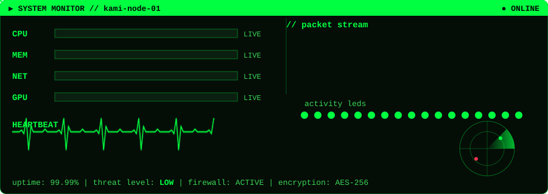

  

  

  
  
  
  

  

<h3 align="center"><code>&gt;_ SYSTEM MONITOR</code></h3>

  

<h3 align="center"><code>&gt;_ ARSENAL</code></h3>

  

<h3 align="center"><code>&gt;_ OPERATOR STATS</code></h3>

  
  

  

<h3 align="center"><code>&gt;_ ./snake --consume-commits</code></h3>

  <picture>
    <source media="(prefers-color-scheme: dark)" srcset="https://raw.githubusercontent.com/Kami-shah733/Kami-shah733/output/snake-dark.svg" />
    <source media="(prefers-color-scheme: light)" srcset="https://raw.githubusercontent.com/Kami-shah733/Kami-shah733/output/snake.svg" />
    
  </picture>

  

